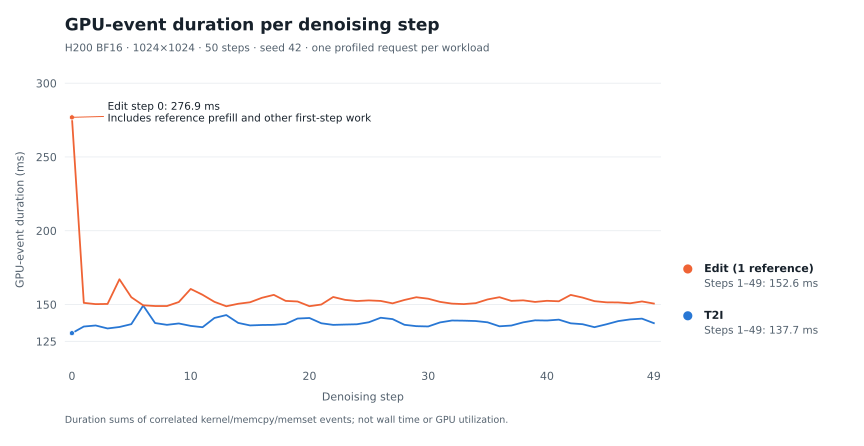
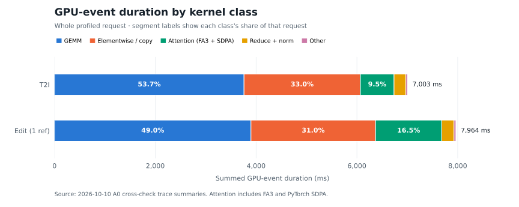

# A0 cross-review: Qwen-Image 2.1 on Runpod H200

Independent BF16 reproduction by Dmaner of [luca-888's A0 report](https://github.com/luca-888/qwen-image-21-bench/blob/cf99e73c8fa1603718c47405730d94c9fbfe6e16/A0_REPORT.md) for [vLLM-Omni #8586](https://github.com/vllm-project/vllm-omni/issues/8586). Experiments: **2026-10-10**; report: **2026-10-12**. This is the earlier A0 cross-check; C1's later FP8 comparisons use their own fresh BF16 controls.

**Result:** the two fixed workloads reproduce A0's output pixels, peak memory and similar request latency. The GPU-event structure and cost distribution agree; absolute trace timings differ. This is a small-sample cross-check, not statistical equivalence or broad quality acceptance.

## Setup

| Setting | Reproduction |
|---|---|
| Code / reference harness | vLLM-Omni `3dc35694b3d458fc1461a8fe71832ac12e8c8cea`; A0 harness `cf99e73c8fa1603718c47405730d94c9fbfe6e16` |
| Model | `Qwen/Qwen-Image-2.1@d26bb61231c349cf6b7896fa83353113880e1ba3` |
| Hardware | 1× NVIDIA H200 SXM, Runpod; driver **595.91.07**; the completed runs used the same GPU |
| Core packages | Python 3.12.3; vLLM 0.31.0; PyTorch 2.13.0+cu130; Triton 3.7.1; Transformers 5.14.1; Diffusers 0.40.0 |
| Workload | BF16, eager, **1024×1024, 50 steps, seed 42, CFG 1**, batch/concurrency 1; no quantization, offload, VAE tiling or compile |
| Attention / prefix | Platform-default `FLASH_ATTN`; FA3 SM90 observed in traces. Native BF16 prefix KV and unquantized attention follow the pinned source and unset dtype overrides; no independent runtime KV-dtype probe in this historical run |
| T2I | `A ceramic teapot on a wooden table` |
| Editing | `Let this mascot dance under the moon, surrounded by floating stars`; identical [514×556 bear input](figures/reference.png) |
| Sampling budget | Timing/serving: 1 warmup + 1 feasibility + **2 measured**. Memory/stage diagnostics: 1 warmup + 2 measured. Each trace: 1 warmup + 1 profiled request |

## 1. Latency and pipeline stages

The timing runs keep A0's synchronized stock stage profiler. They do not enable torch-profiler tracing or the extended stage hook. Wall time covers `omni.generate`; initialization, warmup and PNG encoding/writing are excluded. **± is sample standard deviation of two requests in one process**, not a confidence interval.

| Measurement | T2I | Edit (1 reference) |
|---|---:|---:|
| **Request wall time** | **7.3791 ± 0.0223 s** | **8.4615 ± 0.0117 s** |
| `diffuse` | 7.168 s (97.1%) | 8.103 s (95.8%) |
| `text_encoder.forward` | 0.024 s (0.3%) | 0.070 s (0.8%) |
| `vae.encode` | — | 0.033 s (0.4%) |
| `vae.decode` | 0.113 s (1.5%) | 0.113 s (1.3%) |
| Outside those stages | 0.074 s (1.0%) | 0.143 s (1.7%) |
| Engine initialization, excluded | 13.68 s | 10.33 s |
| Generation failures / OOM | 0 / 0 | 0 / 0 |
| Within-group output determinism | 4/4 identical PNG hashes | 4/4 identical PNG hashes |

Engine stage time is 7.377 / 8.460 s, within 2 ms of the respective wall time. [Calculated tables and source run IDs](data/a0-cross/review_metrics.json); original rows are in the [compact data package](https://github.com/Dmaner/qwen-image-21-bench/releases/download/c1-h200-20261011/C1-H200-essential-data-20261011.zip).

### Full pipeline accounting

A separate `--stages` run uses A0's pre/post-processing hook and additional synchronized timing points. Indented rows are nested and **must not be added together**.

| Stage | T2I | Edit |
|---|---:|---:|
| **Wall time, n=2** | **7.312 s** | **8.488 s** |
| Pre-process | 0.000 s | 0.046 s |
| Pipeline forward | 7.277 s | 8.398 s |
| ↳ Prepare generation context | 0.029 s | 0.225 s |
| ↳ ↳ Encode prompt | 0.028 s | 0.186 s |
| ↳ ↳ ↳ Text encoder | 0.026 s | 0.070 s |
| ↳ ↳ Prepare latents | 0.000 s | 0.038 s |
| ↳ ↳ ↳ VAE encode | 0.000 s | 0.033 s |
| ↳ ↳ Prepare timesteps | 0.000 s | 0.000 s |
| ↳ Denoise | 7.134 s | 8.058 s |
| ↳ Decode latents | 0.114 s | 0.114 s |
| ↳ ↳ VAE decode | 0.113 s | 0.113 s |
| Post-process | 0.031 s | 0.039 s |
| Outside pre/forward/post | 0.003 s | 0.006 s |

Only about 3.3 / 5.6 ms remains outside pre-process, forward and post-process. Editing's context preparation includes image-conditioned prompt work as well as the text encoder; nested stages do not isolate each operation's causal cost.

### Separate diagnostic runs

All runs below used the same physical H200, unlike A0's cross-container table. Different instrumentation means their differences are **not** a clean estimate of run-to-run variance.

| Run, mean of two measured requests | T2I | Edit |
|---|---:|---:|
| Timing | 7.379 s | 8.462 s |
| Memory diagnostic | 7.361 s | 8.489 s |
| Extended stage diagnostic | 7.312 s | 8.488 s |

| T2I output | Edit input | Edit output |
|:---:|:---:|:---:|
|  |  |  |

These existing gallery files originated in the later Phase 2 quality run. Their PNG bytes match both this cross-check's timing `measured_0` images and A0's corresponding originals, as recorded in the [image audit](data/a0-cross/publication_evidence.json). They are reused to avoid duplicate attachments; their original provenance is unchanged.

## 2. Serving measurements

Sequential `/v1/images/generations` requests, `response_format=b64_json`, same workload and two measured requests:

| Measurement | Result |
|---|---:|
| Process to ready, including weight loading | 24.04 s |
| Client request latency | **7.4598 ± 0.0130 s** |
| Engine generation time | 7.3630 s |
| Engine denoising step metric | 143.48 ms |
| Headers received minus engine time | 0.0923 s (1.24%) |
| Body transfer | 0.0045 s; 5.60 MB JSON / 4.20 MB PNG |
| Client JSON / base64 / PNG decode | 0.0094 / 0.0121 / 0.0151 s |

The headers-minus-engine residual includes HTTP handling, hand-off and response encoding; it is **an upper bound on encoding, not a separately timed encoding stage**. Client decode timings are recorded separately from response transfer.

The separate shared serving benchmark used three requests at concurrency 1 and completed 3/3, with **7.4148 s** mean engine time. Across all nine completed experiment groups, the 16 T2I and 12 editing outputs match A0's corresponding decoded RGB pixels. These are repeats of **two fixed inputs**, including warmup and diagnostics, not 28 independent quality cases. [Cross-check records](data/a0-cross/comparison.json)

## 3. Where the time goes inside denoising (torch-profiler traces)

Both traces contain all **50 steps**. The unchanged [A0 analyzer](https://github.com/luca-888/qwen-image-21-bench/blob/cf99e73c8fa1603718c47405730d94c9fbfe6e16/bench/analyze_trace.py) attributes GPU events to Python frames through their correlated CPU launch timestamps. Its `gpu_busy_ms` is a **sum of kernel/memcpy/memset durations**, not a union of busy intervals or a utilization measurement. Use unprofiled timing runs for request latency.

| Per-step measurement | T2I | Edit |
|---|---:|---:|
| GPU-event duration, step 0 | 130.56 ms | 276.86 ms |
| GPU-event duration, steps 1–49 mean | **137.69 ms** | **152.62 ms** |
| Unprofiled `diffuse / 50` | 143.35 ms | 162.06 ms |
| GPU events/step, steps 1–49 | 1,832 | 1,832 |
| GPU events, step 0 | 1,972 | 2,074 |

Editing's first step exceeds its later-step mean by **124.24 ms**, including reference-prefix prefill and other first-step work; this is not a prefill-only ablation. Later edit steps cost **14.93 ms** more than T2I. Whole-request attention-event time is approximately **669 / 1,315 ms** for T2I/edit.

GPU-event duration by kernel class, as a share of the whole request:

| Class | T2I | Edit |
|---|---:|---:|
| GEMM | 53.69% | 48.95% |
| Elementwise / copy / cat / casts | 32.96% | 31.01% |
| Attention kernels (FA3 + PyTorch SDPA) | 9.55% | 16.51% |
| Reduce + norm | 3.33% | 3.05% |

Both figures use this review's recorded trace summaries. [Plotting source and reproduction](reproduce/a0-cross/README.md#report-figures).

Within Transformer blocks, with a different denominator:

| Module | T2I | Edit |
|---|---:|---:|
| Attention module, including projections / norm / RoPE | 49.21% | 53.73% |
| SwiGLU MLP | 40.21% | 36.70% |
| Remaining modulation / residual / gating | 10.58% | 9.58% |

The attention **module** includes projections, normalization and RoPE, so it is larger than the attention-kernel category. The latter includes both FA3 and PyTorch SDPA events across the request. [T2I trace analysis](data/a0-cross/t2i_trace_analysis.json) · [Edit trace analysis](data/a0-cross/edit_trace_analysis.json)

## 4. GPU memory

Binary units throughout: GiB = 1024³ bytes. The worker's independent per-request peak counters supply allocated/reserved; `nvidia-smi` supplies sampled whole-device usage.

| Measurement | T2I | Edit | Source |
|---|---:|---:|---|
| **Peak allocated** | **36.86 GiB** | **36.87 GiB** | Separate memory run |
| Peak reserved | 38.12 GiB | 39.28 GiB | Separate memory run |
| Sampled device used, timing runs | 38.87 GiB | 40.04 GiB | Includes CUDA context; not allocated memory |
| Allocated at snapshot end | 30.29 GiB | 30.29 GiB | Trace snapshot |
| Peak location / increase over end | VAE decode / +6.56 GiB | VAE decode / +6.57 GiB | Allocation stack at the peak |
| Highest recorded denoising allocation | 30.87 GiB | 32.88 GiB | Retained snapshot window only |

The engine's `peak_memory_mb` corresponds to **reserved MiB**, not allocated memory. The bounded snapshots retain 100,000 allocator events, about 2.82 / 3.10 seconds. Their VAE-decode peaks agree with the independent whole-request counters **at 0.01 GiB reporting precision**; this supports the peak-location conclusion without claiming the snapshots contain the entire request. [T2I memory analysis](data/a0-cross/t2i_memory_snapshot_analysis.json) · [Edit memory analysis](data/a0-cross/edit_memory_snapshot_analysis.json)

## 5. Findings

- Denoising accounts for **97.1% / 95.8%** of T2I/edit headline latency. GEMM is roughly half of GPU-event time, and elementwise/copy about one third. The same major optimization targets identified by A0 remain visible.
- Editing adds first-step reference processing and higher steady-state attention cost. The traces do not isolate every cause of that difference.
- VAE decode determines peak allocated memory, approximately **6.6 GiB above the end-of-request allocation**. This run did not test a VAE/offload optimization.
- Timing, memory and output checks support a reproducible fixed-workload BF16 baseline. They do not establish FP8 quality, consumer-GPU support or a specific graph/compile speedup.

## Evidence and reproduction

- [Report metrics](data/a0-cross/review_metrics.json), [original comparison](data/a0-cross/comparison.json), [independent experiment review](data/a0-cross/final-review.json).
- [Compact raw records](https://github.com/Dmaner/qwen-image-21-bench/releases/download/c1-h200-20261011/C1-H200-essential-data-20261011.zip) already contain `a0-cross/results/`: original `runs.jsonl`, `summary.json`, `env.json`, commands, stage/worker-memory records and profile summaries. [Package hashes and member list](data/README.md). Full raw traces, memory pickles and repeated-image corpus remain local.
- [Pinned upstream harness and analyzers](https://github.com/luca-888/qwen-image-21-bench/blob/cf99e73c8fa1603718c47405730d94c9fbfe6e16/bench); [cross-check analysis](reproduce/a0-cross/README.md). Completed runs preserve their exact commands in the package.
- Two existing compatibility adapters were used only where required: the serving wrapper adds missing `mem/stages` metadata defaults; the trace stop hook retains Chrome traces/memory snapshots but skips CPU summary/stack/Excel exports after the original aggregation stalled. These are disclosed adaptations, not model changes or new measured runs.

## Differences from A0

| Comparable measurement | A0 | This review | Difference |
|---|---:|---:|---:|
| T2I request latency | 7.3869 s | 7.3791 s | -0.11% |
| Edit request latency | 8.3630 s | 8.4615 s | +1.18% |
| Serving client latency | 7.4529 s | 7.4598 s | +0.09% |
| Steady-step GPU-event duration, T2I | 131.97 ms | 137.69 ms | +4.33% |
| Steady-step GPU-event duration, edit | 145.75 ms | 152.62 ms | +4.72% |
| Allocated / reserved peaks | 36.86/38.12 GiB T2I; 36.87/39.28 GiB edit | Same | Match at reported precision |

- **Environment:** identical prompt/seed/reference input, model/Omni revisions and core package versions; different provider, host and driver (**580.95.05 → 595.91.07**). A0 used several physical H200s; this reproduction used one. A0's historical image digest/full dependency lock was unavailable. The shallow checkout also produces a different Omni distribution-version string despite the same source SHA.
- **Startup differs substantially:** T2I/edit initialization **34.92/29.12 → 13.68/10.33 s**; serving ready **72.07 → 24.04 s**. Cold-start conditions were not controlled across providers, so these are observations, not inference speedups.
- **Trace structure agrees, absolute time differs:** both have 50 steps and 1,832 correlated GPU events per steady step. Principal kernel/module shares differ by less than 0.5 percentage points, while steady-step GPU-event duration is approximately 4–5% higher here. Neither profiler timing nor initialization is substituted for headline latency.
- **A0's approximately 8% idle estimate is not reproduced:** applying its cross-run arithmetic here gives **3.95%** for T2I. This combines profiled event-duration sums with a separate unprofiled wall interval; it is not measured GPU utilization or confirmed graph/compile headroom.
- **Scope:** 28 saved repeated outputs match the corresponding A0 RGB pixels, covering only two fixed inputs. With n=2 headline measurements, this establishes a small-sample reproduction with similar performance, not statistical equivalence. C1's later BF16/FP8 tables use fresh same-machine controls rather than this historical baseline.
