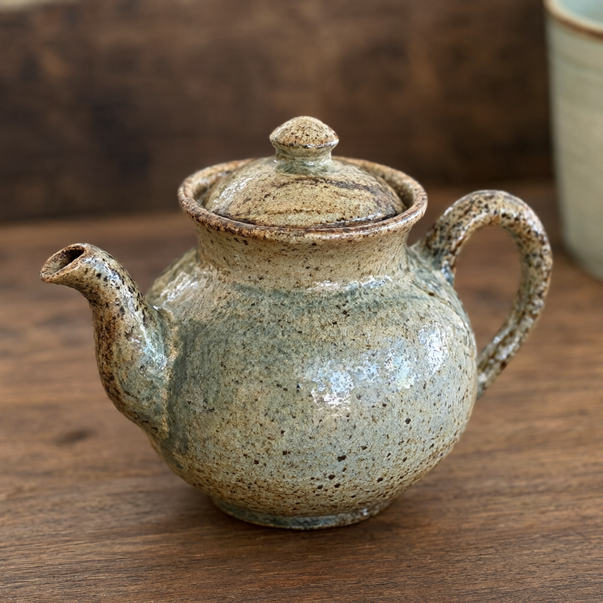
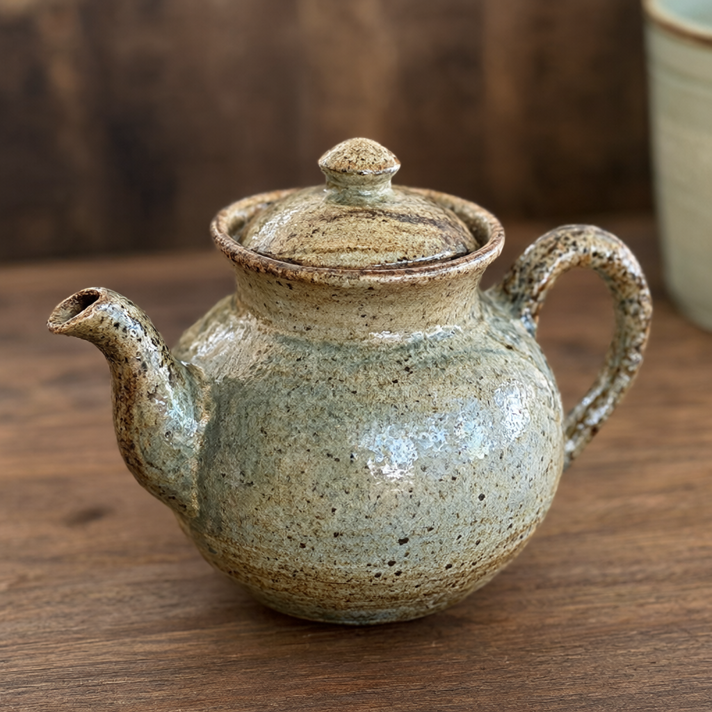
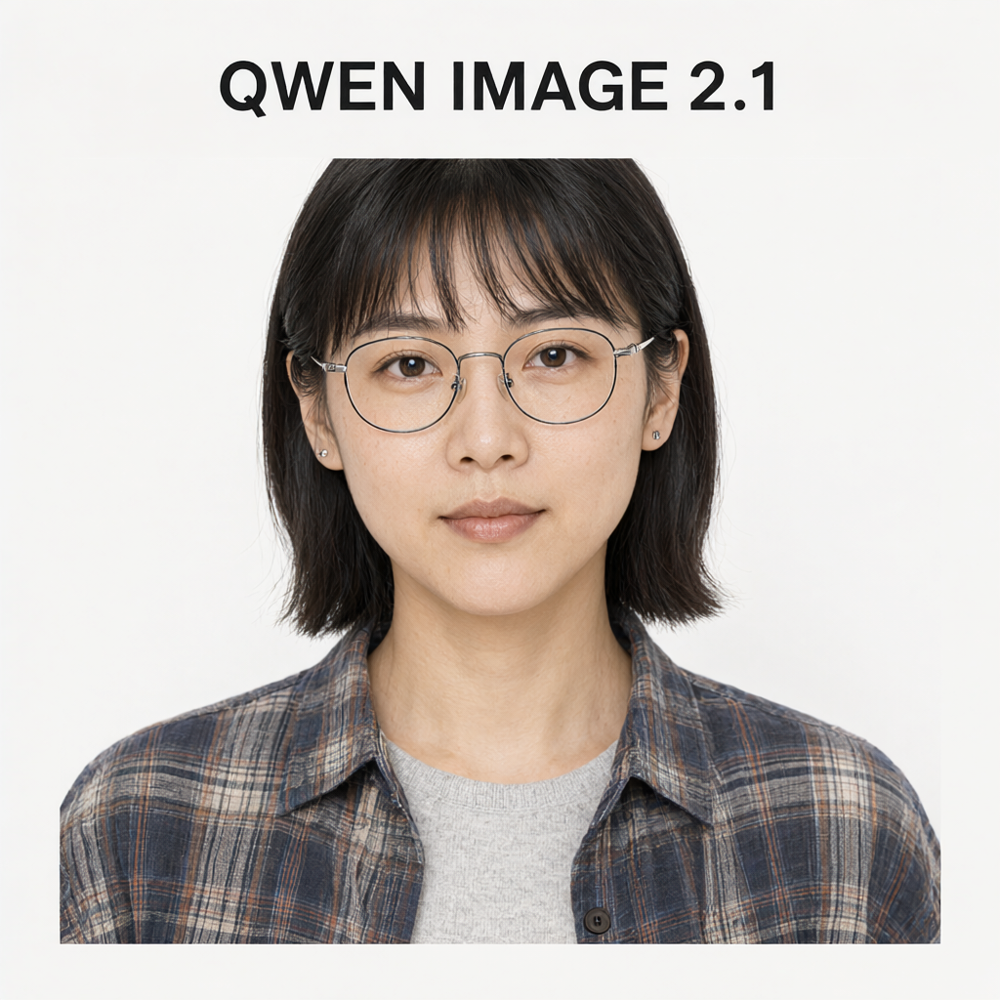
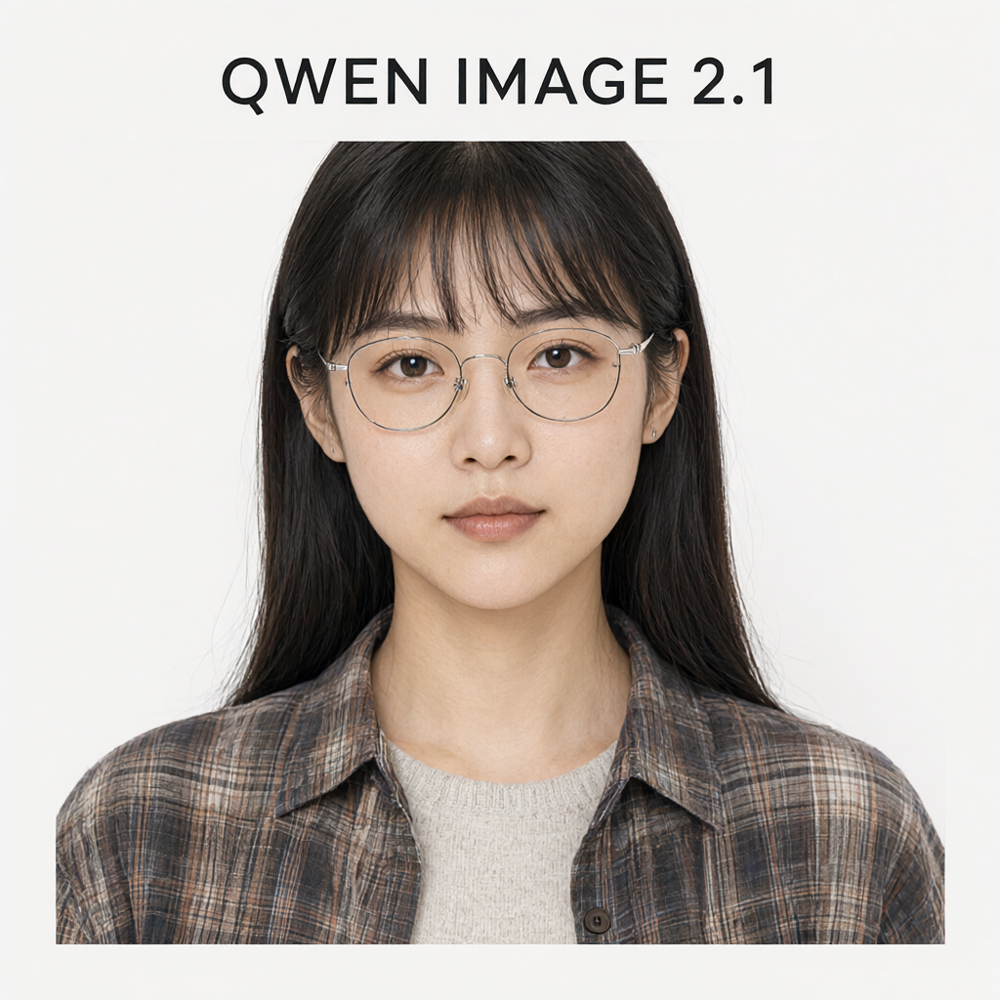
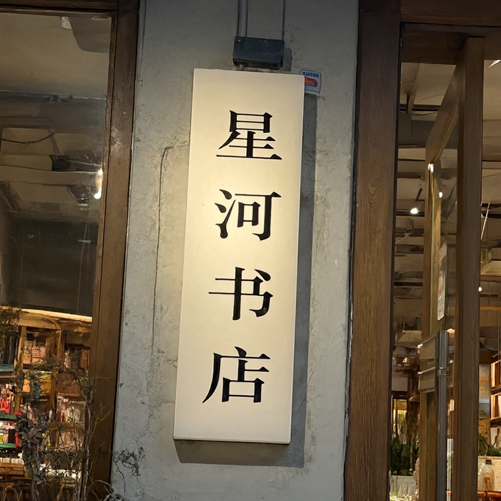
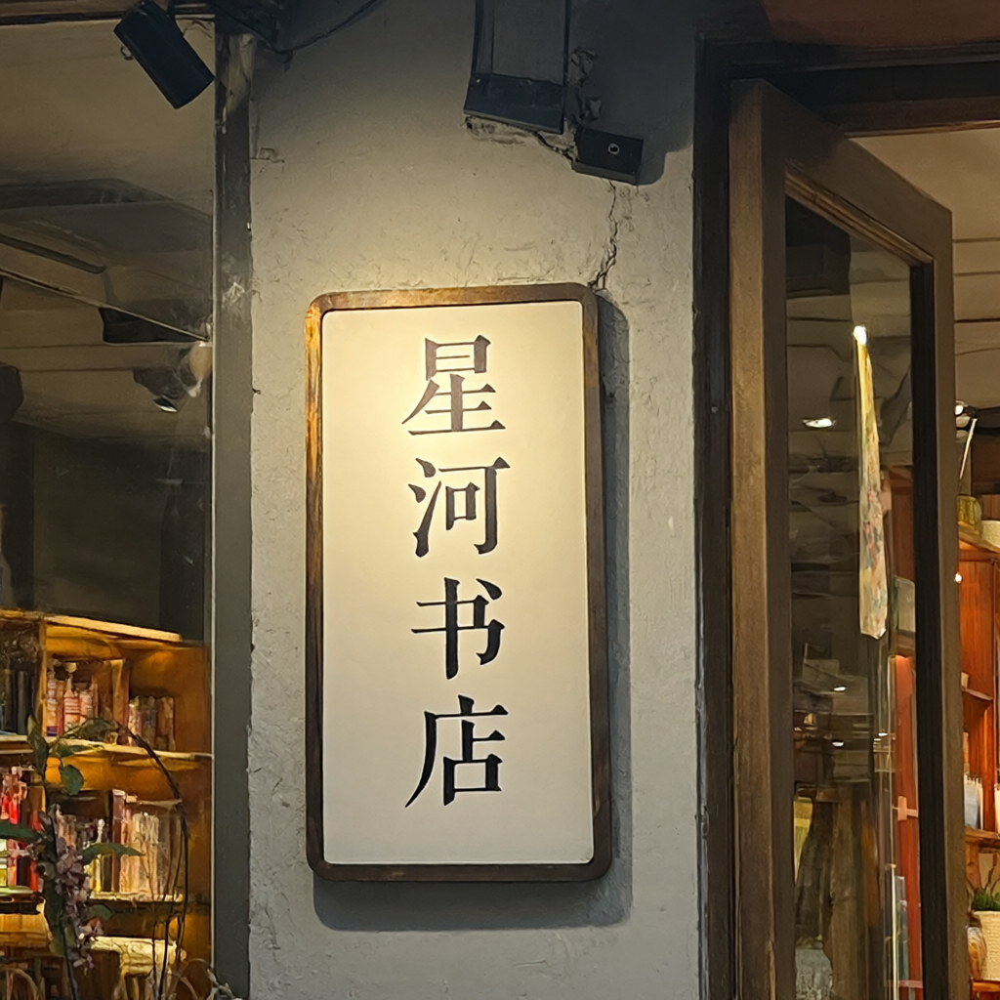
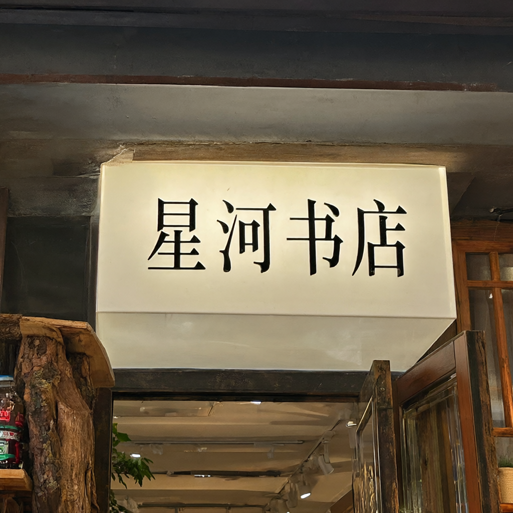

# C1 Phase 2 image gallery

These are **original, byte-for-byte PNGs from the current Phase 2 experiment**. Click any image to open it at full size. All five columns in each case use the same frozen prompt, seed, resolution (1024×1024), 50 steps, and CFG 1 on the same H200. The quantization configuration is the intended difference; identical seeds do not imply identical output pixels.

The first two cases reuse the A0 prompts and seed 42, but the images below are fresh Phase 2 outputs, not images copied from A0. The two text cases illustrate a specific regression and the selective configuration's behavior. These four selected examples are not the full 24-case quality set or a representative quality score.

**Configurations:** DiT FP8 quantizes 160 DiT Linear modules; TE FP8 quantizes 252 language-encoder Linear modules; Joint FP8 combines them. Selective BF16 quantizes 140 DiT Linear modules and keeps blocks 0, 1, 30, and 31 plus the entire TE in BF16. Vision and the LM head stay BF16 in every configuration.

**Review boundary:** Captions summarize the completed, labeled model-assisted review of this experiment. They are not independent human/A0 acceptance or a general quality certification. BF16 already has prompt-following errors, which are retained below. PSNR/SSIM have no agreed pass/fail threshold here, and a favorable selected example does not establish general quality recovery.

PNG hashes, original experiment paths, dimensions, and copy verification are in [figures/manifest.json](figures/manifest.json). Files were not resized, cropped, annotated, or re-encoded.

## A0 T2I prompt — seed 42

**Case:** `t2i_teapot_s42` · **Seed:** 42

> A ceramic teapot on a wooden table

| BF16 | DiT FP8 | TE FP8 | Joint FP8 | Selective BF16 |
| --- | --- | --- | --- | --- |
|  |  |  |  |  |

The review observed a ceramic teapot on a wooden table, with a coherent spout, handle, and lid across all five configurations. No clear new target-object violation was observed in this example; textures and local contours differ.

## A0 single-reference edit prompt — seed 42

**Case:** `edit_bear_s42` · **Seed:** 42

> Let this mascot dance under the moon, surrounded by floating stars

Reference input (514×556, original PNG): 

| BF16 | DiT FP8 | TE FP8 | Joint FP8 | Selective BF16 |
| --- | --- | --- | --- | --- |
|  |  |  |  |  |

Across all five configurations, the review observed the reference bear identity, white Qwen shirt/logo, moonlit setting, floating stars, and dancing pose. Pose and rendering changes are part of the requested edit; this is not a claim of pixel preservation.

## English text regression — seed 43

**Case:** `t2i_english_s43` · **Seed:** 43

> A poster with the exact text "QWEN IMAGE 2.1", clean typography on a plain background.

| BF16 | DiT FP8 | TE FP8 | Joint FP8 | Selective BF16 |
| --- | --- | --- | --- | --- |
|  |  |  |  |  |

BF16 retains the complete requested title but already adds an unrequested portrait. The entire title is missing in DiT FP8 and Joint FP8. TE FP8 and Selective BF16 retain it in this sample. Portrait and layout changes do not by themselves establish a new error; the selective result does not prove general quality recovery or identify sensitive layers.

## Chinese reading-order ambiguity — seed 44

**Case:** `t2i_chinese_s44` · **Seed:** 44

> A front-facing bookstore sign with the exact Chinese text "星河书店", clear readable lettering.

| BF16 | DiT FP8 | TE FP8 | Joint FP8 | Selective BF16 |
| --- | --- | --- | --- | --- |
|  |  |  |  |  |

BF16, TE FP8, and Joint FP8 show a clear vertical reading order; Selective BF16 shows a clear horizontal order. In DiT FP8, all four characters are present, but “河” shifts into another column and the reading order was marked ambiguous. This was not labeled a missing/incorrect character or an exact-text pass; human confirmation remains appropriate.
