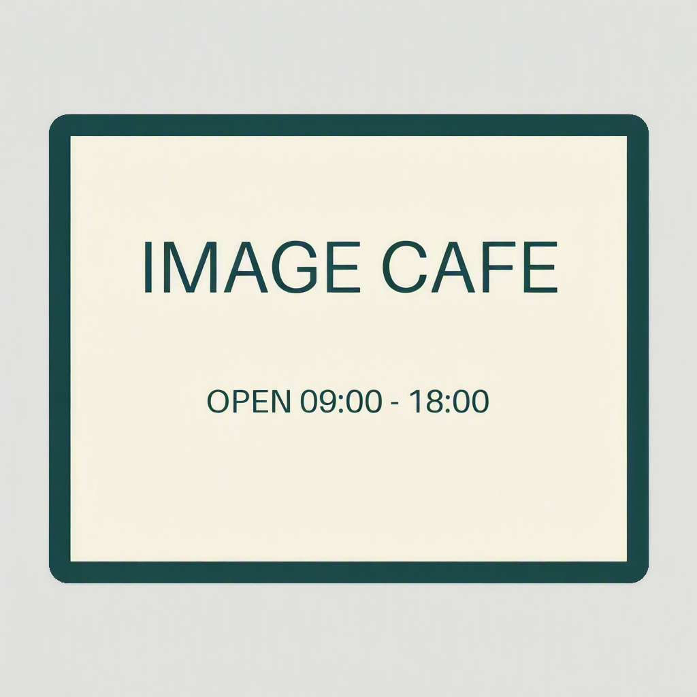
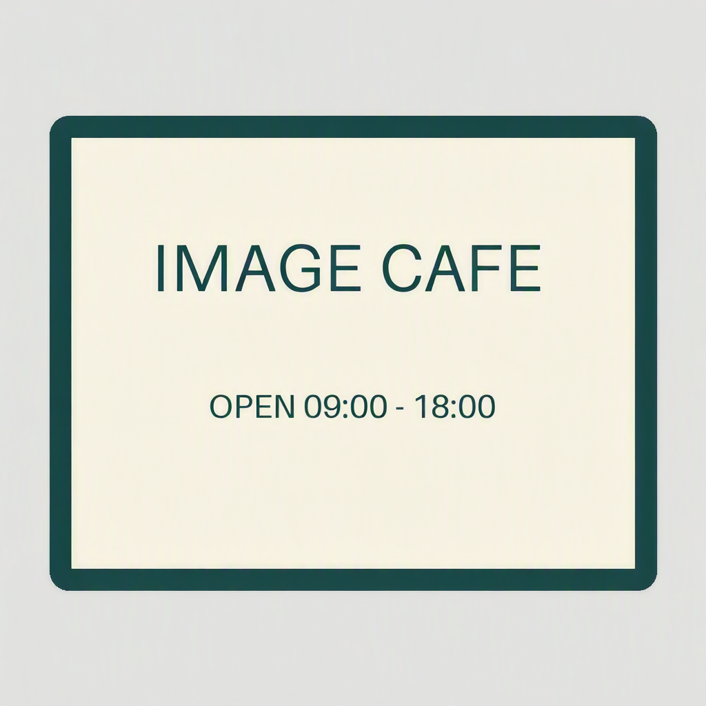
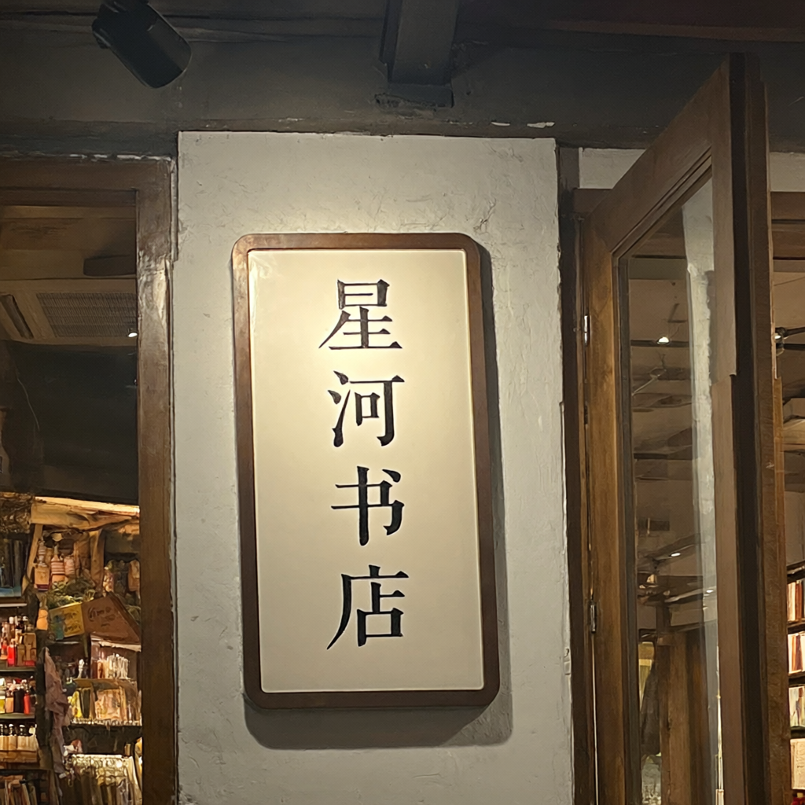
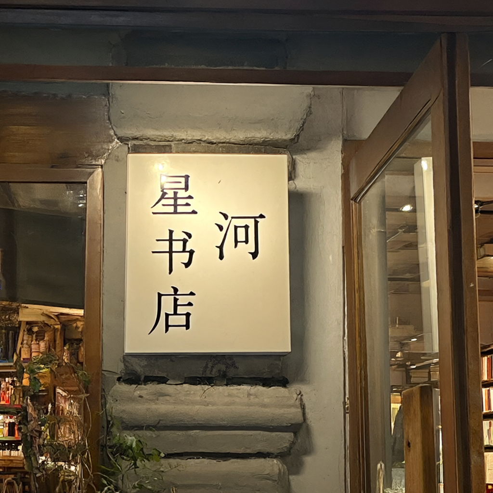
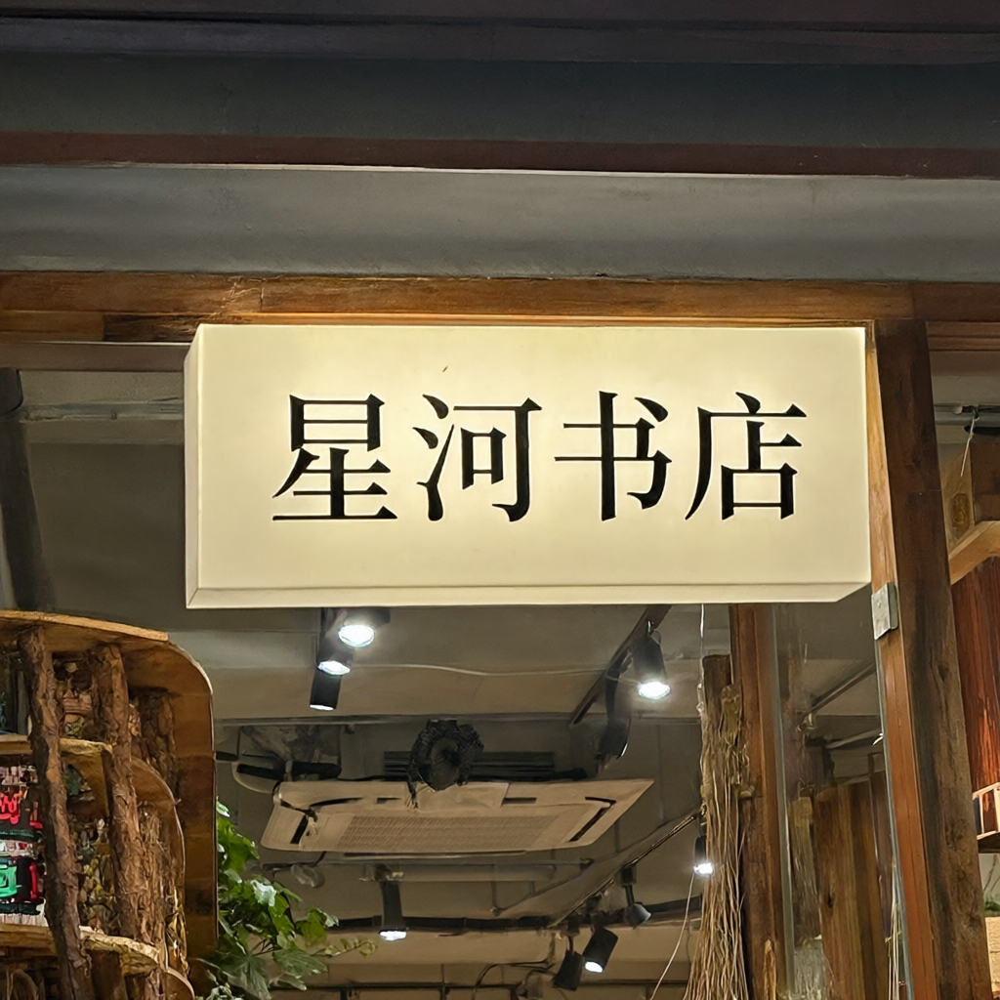

# C1 supplement: selected image comparisons

Each new single-reference input below uses its largest measured candidate LPIPS difference. Images are unchanged output PNGs. Observations are model-assisted; human review remains pending.

## Person background — seed 42

Replace the [reference background](reproduce/supplement/inputs/astronaut.png) with plain light gray while preserving the person and suit.

| BF16 | DiT FP8 |
|---|---|
|  |  |

The background edit is complete in both images; the face, suit, helmet and framing remain close. Fine patch lettering is already redrawn in BF16.

## Coffee color — seed 44

Change the [reference cup exterior and saucer](reproduce/supplement/inputs/coffee.png) to cobalt blue.

| BF16 | DiT + Text Encoder FP8 |
|---|---|
|  |  |

Both retain the blue exterior and saucer, white interior, coffee and metal spoon. Cup geometry and highlights shift slightly.

## Sign text — seed 44

Replace the [synthetic sign](reproduce/supplement/inputs/synthetic_cafe_sign.png) title with `IMAGE CAFE`, preserving `OPEN 09:00 - 18:00`.

| BF16 | DiT FP8 |
|---|---|
|  |  |

Both strings remain correct. DiT FP8 renders a narrower title while keeping the frame and palette.

## Chinese bookstore sign — seed 44

Prompt: `A front-facing bookstore sign with the exact Chinese text "星河书店", clear readable lettering.`

| BF16 | DiT FP8 | MLP BF16 |
|---|---|---|
|  |  |  |

BF16 presents `星河书店` vertically. DiT FP8 places `河` beside the other characters, making reading order ambiguous. MLP BF16 produces the complete text in a horizontal sign, with a different composition.

[Back to C1 report](C1_REPORT.md) · [All per-case scores](data/supplement-20261013/quality_pairs.csv).
